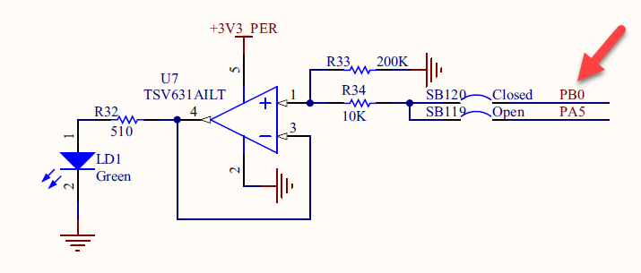
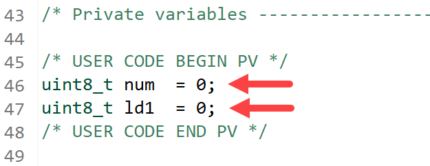
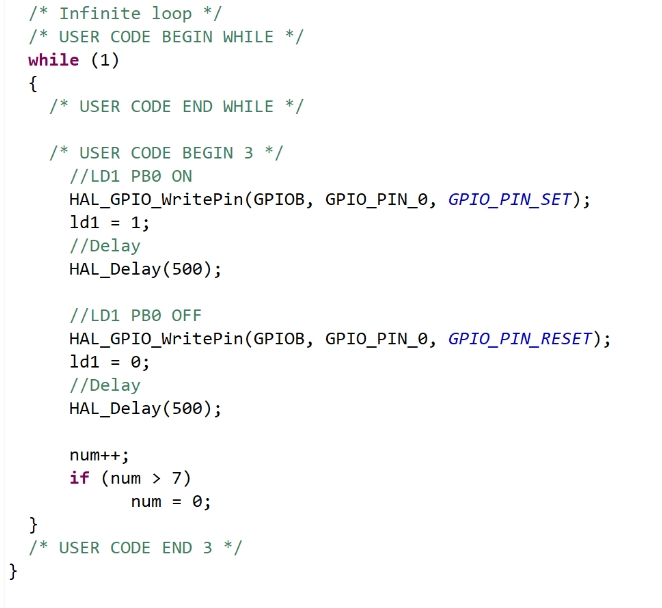
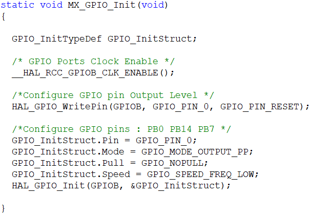
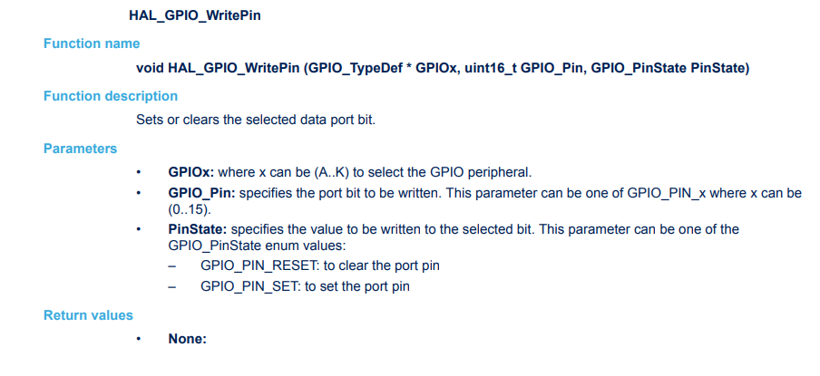
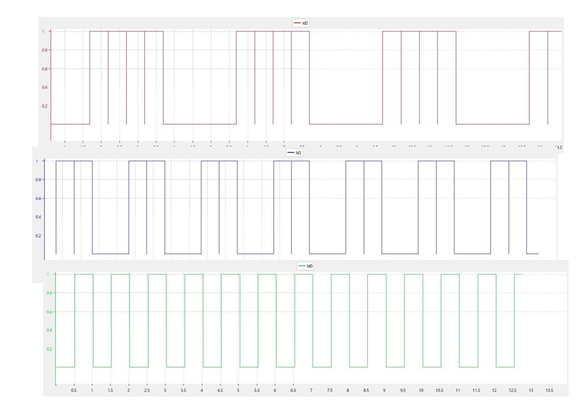

# 01276314 Microcontroller Interfacing, 2026 — Lab 1: On-board LEDs and Debug Mode

Computer Engineering International Program · Department of Computer Engineering, KMITL

---

## Page 1

**Lab 1 On-board LEDs and debug mode**

**Objectives**

1. Programming on-board LEDs
2. Use debug mode provided by STM32CubeIDE

### 1. On-board LED Schematic Diagram

The LD1 that connects to microcontroller using GPIO port B pin 0 (PB0) is one of three user LEDs on Nucleo-F767ZI board and displays green light. According to schematic diagram in Fig 1, LD1 light glows when applying logic 1 (3.3 V) from microcontroller pin and its light is turned off when applying logic 0.



> **[Figure 1]** Shows connectivity of user LED LD1 and PB0 pin.

### 2. Programming

Open existing project from Lab 0 and modify the previous source code as the following:

- Declare two global variables `num` and `ld1` as shown in Fig 2.
- Then modify the code inside the infinite loop as shown in Fig 3.

When writing more code into file `main.c`, it should be placed between two comments `/* USER CODE BEGIN x */` and `/* USER CODE END x */` where x is the numbering such as 1, 2, or 3 because the user code outside the specific comment range will be deleted after code regeneration from STM32CubeMX.



> **[Figure 2]** Global variable declaration.

---

## Page 2



> **[Figure 3]** Modify the code inside the infinite loop.

### 3. Code Explanation

The program starts with the execution from function `main()` in file `main.c` that executes in the following manner:

- Function `HAL_Init()` is executed to initialize essential parameters for starting microcontroller. This function can be found in file `stm32f7xx_hal.c`.
- Function `SystemClock_Config()` is executed after function `HAL_Init()` to configure clock divisors and multipliers according to settings in STM32CubeMX. This function can be found in file `stm32f7xx_hal_rcc.c`.
- Function `MX_GPIO_Init()` that are generated from STM32CubeMX is used to configure microcontroller pin PB0 to function as GPIO output as shown in Fig 4. The first statement inside this function that enables clock signal to GPIO port B is

```c
__HAL_RCC_GPIOB_CLK_ENABLE();
```

- Configure pin PB0 to have starting value which is logic 0 according to the setting in STM32CubeMX by this statement

```c
HAL_GPIO_WritePin(GPIOB, GPIO_PIN_0, GPIO_PIN_RESET);
```

- Then prepare parameters for PB0 setting as push-pull output pin with low speed by following statements

```c
GPIO_InitStructure.Pin                = GPIO_Pin_0;
GPIO_InitStruct.Mode                  = GPIO_MODE_OUTPUT_PP;
GPIO_InitStruct.Pull                  = GPIO_NOPULL;
GPIO_InitStruct.Speed                 = GPIO_SPEED_FREQ_LOW;
```

- Finally, call the following function to effectively configure PB0

```c
HAL_GPIO_Init(GPIOB, &GPIO_InitStruct);
```

---

## Page 3



> **[Figure 4]** Detail of function `MX_GPIO_Init`.

- Variable `GPIO_InitStruct` has the data type `GPIO_InitTypeDef` that has detail as the following

```c
typedef struct
{
  uint32_t Pin;                    //specify pin to be configured
  uint32_t Mode;                   //specify pin mode
  uint32_t Pull;                   //specify function of internal resistor
  uint32_t Speed;                  //specify pin switching speed
} GPIO_InitTypeDef;
```

- `GPIOB` is the pointer that declare from macro in file `stm32f767xx.h`.

```c
#define GPIOB ((GPIO_TypeDef *) GPIOB_BASE)
```

- `GPIOB` is the pointer that points to the beginning address of GPIO port B and has data type `GPIO_TypeDef` that contains all registers of GPIO ports B as shown in the following box

```c
typedef struct
{
  __IO uint32_t CRL;  //Control Register Low
  __IO uint32_t CRH;  //Control Register High
  __IO uint32_t IDR;  //Input Data Register
  __IO uint32_t ODR;  //Output Data Register
  __IO uint32_t BSRR; //Bit Set/Reset Register
  __IO uint32_t BRR;  //Bit Reset Register
  __IO uint32_t LCKR; //Configuration Lock Register
} GPIO_TypeDef;
```

- The first statement inside infinite loop from Fig 3 is `HAL_GPIO_WritePin(GPIOB, GPIO_PIN_0, GPIO_PIN_SET)` to set pin PB0 as logic 1 that makes LD1 light glows.
- Global variable `ld1` is used for debugging purposes. Since variable `ld1` replicates its value from pin PB0 by statement `ld1 = 1`, STM32CubeIDE can indirectly monitor pin PB0 by observing variable `ld1`.
- Statement `HAL_Delay(500)` is used to delay the execution for 500 ms so LED light can be observed for 500 ms.

---

## Page 4

- Statement `HAL_GPIO_WritePin(GPIOB, GPIO_PIN_0, GPIO_PIN_RESET)` is used to set pin PB0 as logic 0 as a result LD1 is turned off.
- Statement `ld1 = 0` is used to set variable `ld1` as integer 0 to replicate PB0 logic.
- Statement `HAL_Delay(500)` is used to delay the execution for 500 ms so LED light that is turned off can be observed for 500 ms.
- Function `HAL_GPIO_WritePin` and other functions related to GPIO module can be further studied from file `stm32f7xx_hal_gpio.h` and `stm32f7xx_hal_gpio.c` or from user manual document UM1905 *Description of STM32F7 HAL and low-layer drivers* as shown in Fig 5.



> **[Figure 5]** Detail of function `HAL_GPIO_WritePin`.

---

## Page 5

### 4. The debug mode on STM32CubeIDE

The debug mode is an important feature for software development on microcontroller units just like any software development. The difference is in the debug mode for microcontroller unit the result has occurred on microcontroller unit but retrieved and displayed on cross-platform toolchain on the computer.

Several cross-platform toolchains used for developing software on microcontroller units have many debugging features. For example, STM32CubeIDE can set breakpoints, read variable values, read values from memory location, read register values, and show reading values in real time by using Serial Wire Viewer.

The tutorial on how to use debug mode on STM32CubeIDE can be found at the following URL:

https://youtu.be/7jw-9-8j2ok (Thai) or https://youtu.be/KTExdKSlNDU (English).

---

## Page 6

### 5. Experiment

1. Open existing project from Lab 0 and modify the code as shown in Fig 2 and Fig 3. Study the debug mode from the tutorial clip and then display PB0 status using SWV Data Trace Timeline Graph.
2. Use the code from Experiment 1 and modify it to display the timing diagram of three-bit up-counter. Use PB14, PB7, and PB0 pins as a three-bit counter and assign PB14 and PB0 as MSB and LSB respectively. Delay time for the counter is 300 ms. Separately, display and capture the result from each pin in SWV Data Trace Timeline Graph. Finally, show the result obtained from three pins as shown in Fig 6.



> **[Figure 6]** Timing diagram obtained from Experiment 2.

---

## Page 7

### Lab 1 Submission

*Microcontroller Interfacing 2026*

Date **\_\_\_\_\_\_\_\_\_\_\_\_\_\_\_\_\_\_\_**  Lab Group No. **\_\_\_\_\_\_\_\_\_\_\_\_**

1. Student ID **\_\_\_\_\_\_\_\_\_\_** Name **\_\_\_\_\_\_\_\_\_\_\_\_\_\_\_\_\_\_\_\_\_\_\_\_**
2. Student ID **\_\_\_\_\_\_\_\_\_\_** Name **\_\_\_\_\_\_\_\_\_\_\_\_\_\_\_\_\_\_\_\_\_\_\_\_**
3. Student ID **\_\_\_\_\_\_\_\_\_\_** Name **\_\_\_\_\_\_\_\_\_\_\_\_\_\_\_\_\_\_\_\_\_\_\_\_**

**Checkpoints**

- Experiment 1
- Experiment 2

**Question**

1. GPIO B is the macro pointer that points to the beginning address of GPIO port B module. Specify the beginning address of GPIO port B and the section it belongs to in memory space.

\_\_\_\_\_\_\_\_\_\_\_\_\_\_\_\_\_\_\_\_\_\_\_\_\_\_\_\_\_\_\_\_\_\_\_\_\_\_\_\_\_\_\_\_\_\_\_\_\_\_\_\_\_\_\_\_\_\_\_\_\_\_\_\_\_\_\_\_\_\_\_\_\_\_\_\_\_\_

\_\_\_\_\_\_\_\_\_\_\_\_\_\_\_\_\_\_\_\_\_\_\_\_\_\_\_\_\_\_\_\_\_\_\_\_\_\_\_\_\_\_\_\_\_\_\_\_\_\_\_\_\_\_\_\_\_\_\_\_\_\_\_\_\_\_\_\_\_\_\_\_\_\_\_\_\_\_

\_\_\_\_\_\_\_\_\_\_\_\_\_\_\_\_\_\_\_\_\_\_\_\_\_\_\_\_\_\_\_\_\_\_\_\_\_\_\_\_\_\_\_\_\_\_\_\_\_\_\_\_\_\_\_\_\_\_\_\_\_\_\_\_\_\_\_\_\_\_\_\_\_\_\_\_\_\_

\_\_\_\_\_\_\_\_\_\_\_\_\_\_\_\_\_\_\_\_\_\_\_\_\_\_\_\_\_\_\_\_\_\_\_\_\_\_\_\_\_\_\_\_\_\_\_\_\_\_\_\_\_\_\_\_\_\_\_\_\_\_\_\_\_\_\_\_\_\_\_\_\_\_\_\_\_\_

\_\_\_\_\_\_\_\_\_\_\_\_\_\_\_\_\_\_\_\_\_\_\_\_\_\_\_\_\_\_\_\_\_\_\_\_\_\_\_\_\_\_\_\_\_\_\_\_\_\_\_\_\_\_\_\_\_\_\_\_\_\_\_\_\_\_\_\_\_\_\_\_\_\_\_\_\_\_
