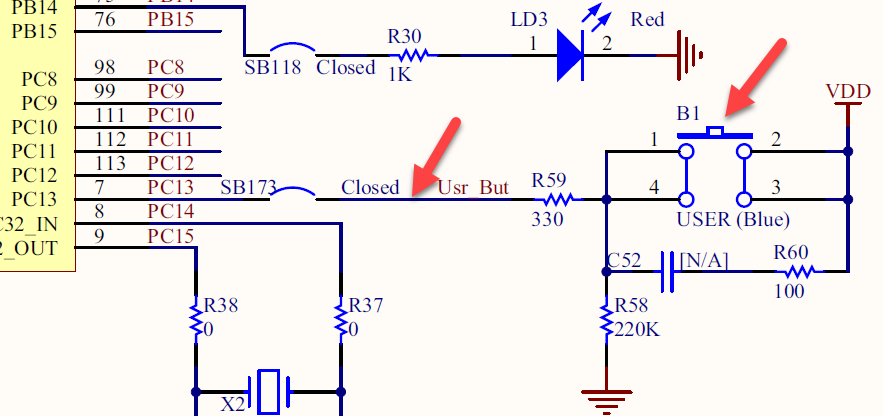
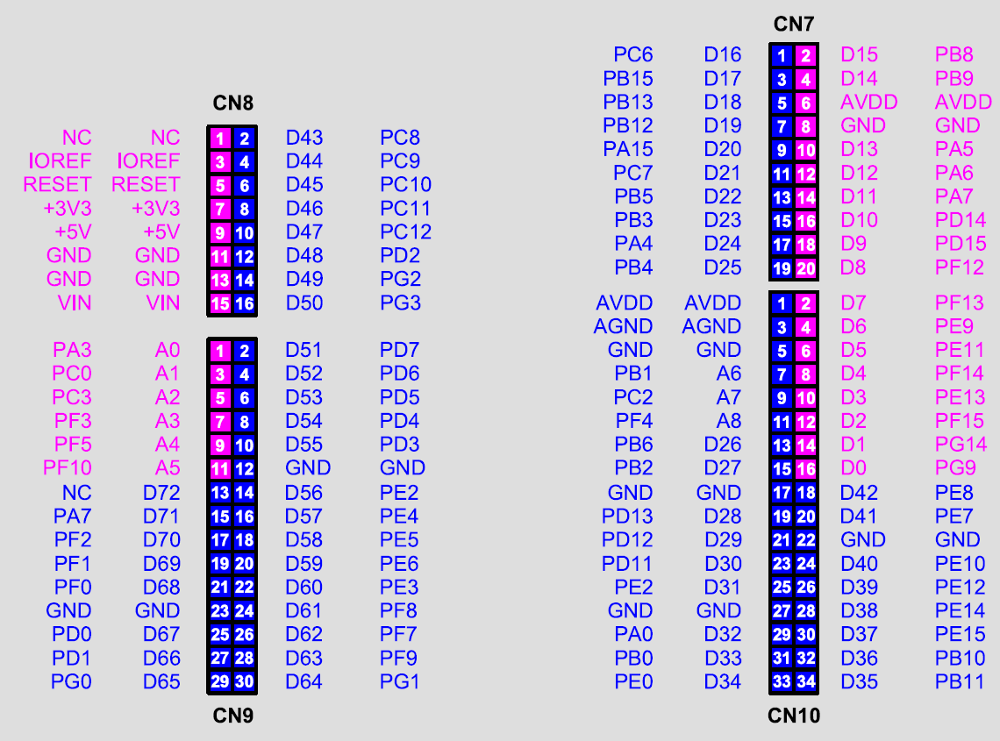
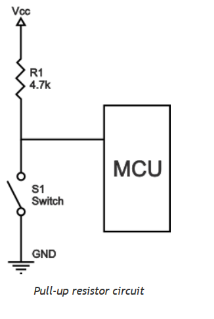
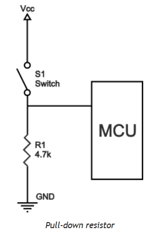
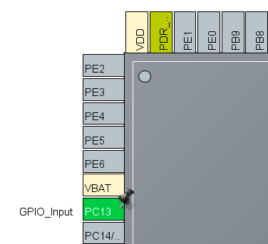
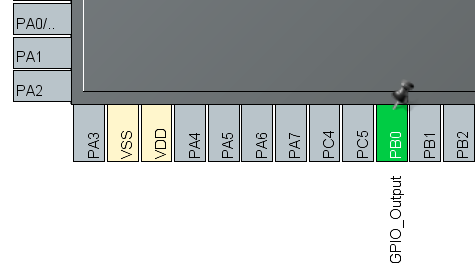
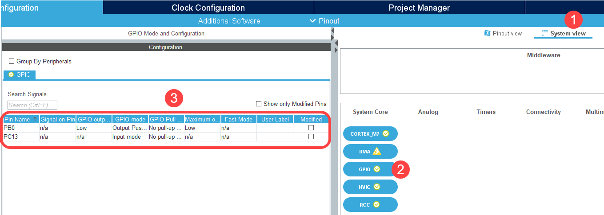
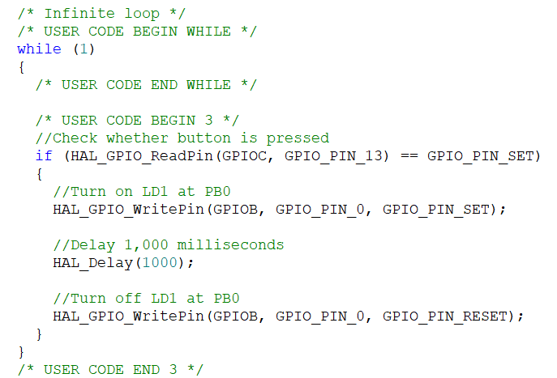

# 01276314 Microcontroller Interfacing, 2026 — Lab 2: GPIO

Computer Engineering International Program · Department of Computer Engineering, KMITL

---

## Page 1

**Lab 2 GPIO**

**Objectives**

1. Students should be able to configure GPIO.
2. Students should be able to read digital input from both on-board and external buttons.

### 1. LEDs and Buttons

There are 1 user button and 3 user LEDs on Nucleo-F767ZI board. The user button B1 has blue color and connects to pin PC13. According to schematic diagram as shown in Fig 1.1, pin PC13 has logic 1 when button B1 is push, otherwise it has logic 0.



> **[Figure 1.1]** Shows schematic diagram of user button B1.

Besides on-board LEDs, external LEDs can be used by connecting to any of four on-board connectors which connects to microcontroller pins as shown in Fig 1.2.



> **[Figure 1.2]** Nucleo-767ZI board pinout.

---

## Page 2

When connecting a push button to a microcontroller pin, a resistor is needed to prevent floating condition when a button is not push. There are two options to place a resistor. The first option is pull-up resistor circuit as shown in Fig 1.3 (a) and the other one is pull-down resistor circuit as shown in Fig 1.3 (b).





> **[Figure 1.3]** Pull-up and pull-down resistor circuits. (a) Pull-up resistor circuit (b) Pull-down resistor circuit.

### 2. Reading Digital Input

GPIO is started initialization by enabling clock signal to the using ports. Then configure each pin to function as an input or an output pin. After that, the output pin is needed to configure pin speed that is LOW, MEDIUM, HIGH, and VERY HIGH.

There are 2 steps to program the microcontroller unit (MCU) to monitor whenever the button B1 is push, turn on the LED LD1 for 1 second and then turn it off.

1. Create a new project just like in Lab 1 and use STM32CubeMX to configure GPIO module as shown in Fig 2.1.
2. Write the code inside the infinite loop as shown in Fig 2.2.

---

## Page 3







> **[Figure 2.1]** Configure GPIO module. (a) Pinout Configuration (b) Pinout Configuration (c) GPIO Configuration



> **[Figure 2.2]** The code inside the infinite loop.

---

## Page 4

### 3. Explanation

**Function `MX_GPIO_Init()`**

- Created by STM32CubeMX to configure GPIO module according to user setting.
- First, it enables clock signal to GPIOC for button B1 and to GPIOB for LED LD1:
```c
__HAL_RCC_GPIOC_CLK_ENABLE();
__HAL_RCC_GPIOB_CLK_ENABLE();
```
- Configure PC13 that connects to button B1 to function as a floating input pin:
```c
GPIO_InitStruct.Pin = GPIO_PIN_13;
GPIO_InitStruct.Mode = GPIO_MODE_INPUT;
GPIO_InitStruct.Pull = GPIO_NOPULL;
HAL_GPIO_Init(GPIOC, &GPIO_InitStruct);
```
- Configure PB0 that connects to LD1 to function as a low-speed push-pull output pin:
```c
GPIO_InitStruct.Pin   = GPIO_PIN_0;
GPIO_InitStruct.Mode  = GPIO_MODE_OUTPUT_PP;
GPIO_InitStruct.Pull  = GPIO_NOPULL;
GPIO_InitStruct.Speed = GPIO_SPEED_FREQ_LOW;
HAL_GPIO_Init(GPIOB, &GPIO_InitStruct);
```

**Function `main()`**

- Starts initializing with the following functions: `HAL_Init()`, `SystemClock_Config()`, and `MX_GPIO_Init()`.
- Read digital input from button B1:
```c
HAL_GPIO_ReadPin(GPIOC, GPIO_PIN_13)
```
- Check whether the button B1 is push:
```c
if (HAL_GPIO_ReadPin(GPIOC, GPIO_PIN_13) == GPIO_PIN_SET)
```

HAL Driver document provides more detail about all functions for GPIO module.

---

## Page 5

### 4. Experiment

1. Write the program that works whenever button B1 is push, turn LED LD1 on for 1 second and then turn it off.
2. Connect an external button to microcontroller pin PA0 and connect an external LED to pin PC8. Make sure to use proper resistors for both external button and LED. Modify the project from Experiment 1 to work according to the following: whenever PA0 button is push, turn on PC8 LED for 1 second and then turn it off. First, both PA0 and PC8 are needed to be configured in STM32CubeMX. Regenerate the code and then modify the code inside the infinite loop.
3. Write the if statement to check whether external LED from Experiment 2 is on.
4. Connect 8 LEDs to microcontroller using pin D0 through D7 and write the program that works according to Table 4.1. The program starts with all LEDs are turned off.

**Table 4.1** shows the LED pattern after the button is push.

| Button | LED Pattern |
|--------|-------------|
| B1 | When B1 is push, turn the glowing LED off and also turn the next LED towards D7_LED on.<br>When all LEDs are off:<br>push B1 → turn D0_LED on.<br>push B1 → turn D0_LED off and D1_LED on<br>push B1 → turn D1_LED off and D2_LED on<br>...<br>push B1 → turn D7_LED off and D0_LED on |
| PA0 | When PA0 button is push, all 8 LEDs start blinking one at a time towards D0 LED with 300 ms delay time. LED stops blinking when it comes back to the starting LED before pushing PA0 button. Start with a glowing LED or D7_LED when there is no glowing LED.<br>Example:<br>If D4_LED is glowing,<br>Push PA0 button → LEDs start blinking in this manner:<br>D3_LED → D2_LED → D1_LED → D0_LED → D7_LED → D6_LED → D5_LED → D4_LED. |

---

## Page 6

**Table 4.1** (continued)

| Button | LED Pattern |
|--------|-------------|
| PA0 | If there is no glowing LED,<br>Push PA0 button → LEDs start blinking in this manner:<br>D7_LED → D6_LED → D5_LED → D4_LED → D3_LED → D2_LED → D1_LED → D0_LED.<br>The all LEDs are off. |

---

## Page 7

**Lab 2 Submission**

*Microcontroller Interfacing 2026*

Date **\_\_\_\_\_\_\_\_\_\_\_\_\_\_\_\_\_\_\_**  Lab Group No. **\_\_\_\_\_\_\_\_\_\_\_\_**

1. Student ID **\_\_\_\_\_\_\_\_\_\_** Name **\_\_\_\_\_\_\_\_\_\_\_\_\_\_\_\_\_\_\_\_\_\_\_\_** 
2. Student ID **\_\_\_\_\_\_\_\_\_\_** Name **\_\_\_\_\_\_\_\_\_\_\_\_\_\_\_\_\_\_\_\_\_\_\_\_** 
3. Student ID **\_\_\_\_\_\_\_\_\_\_** Name **\_\_\_\_\_\_\_\_\_\_\_\_\_\_\_\_\_\_\_\_\_\_\_\_** 

**Checkpoints**

- Experiment 2&3
- Experiment 4

**Questions**

1. Write only 1 statement that makes LED0, LED1, and LED2 that respectively connect to PC8, PC9, and PC10 simultaneously glow.

2. If 3 LEDs connect to pin PC10, PC9, and PC8. Explain the result of the following code.

```c
uint8_t n;

while (1)
  {
       for (n=0; n<=2; n++)
            {
                  GPIOC -> BSRR = 0x07000000;
                  HAL_Delay(500);

                          GPIOC -> BSRR = 0x00000400 >> n;
                          HAL_Delay(500);
                      }
   }
```
