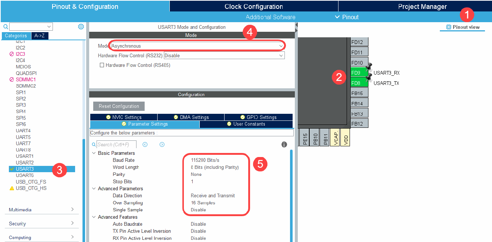
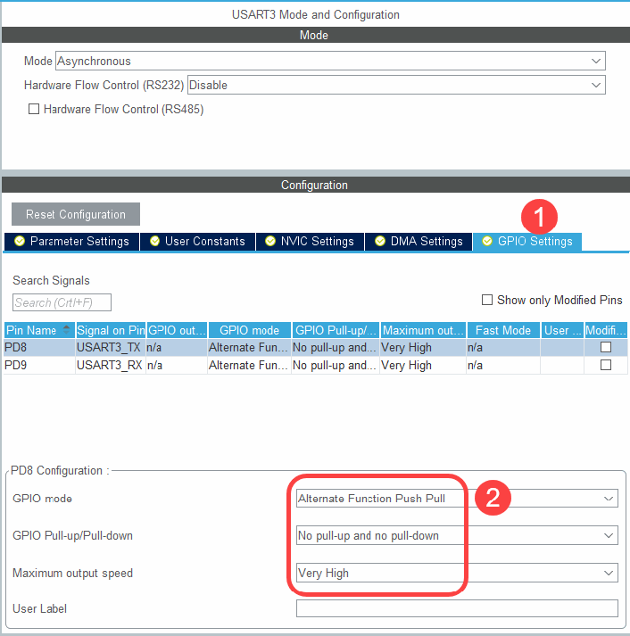
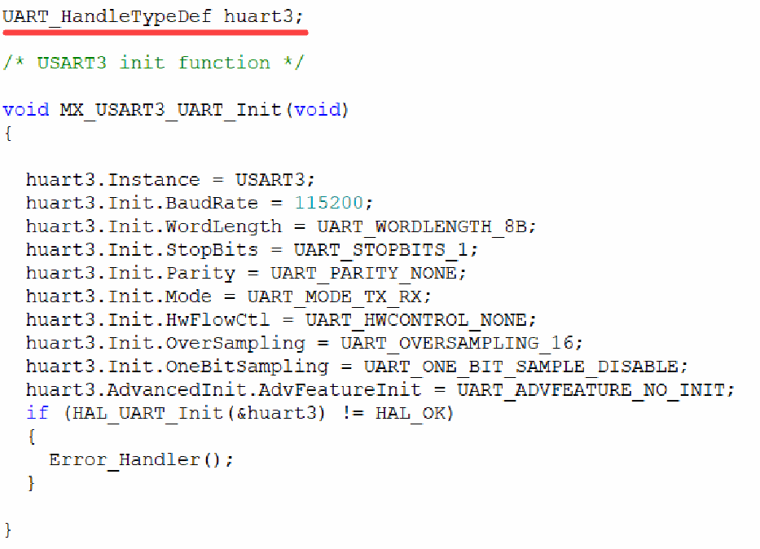
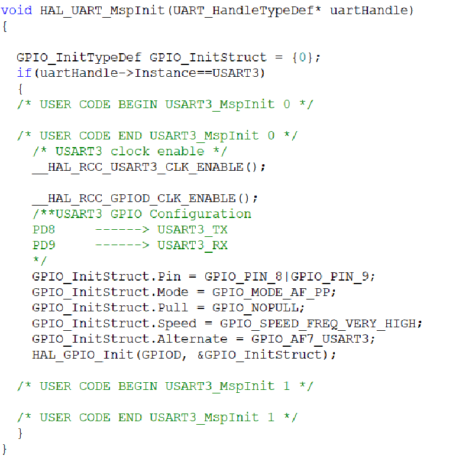
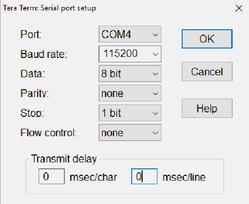
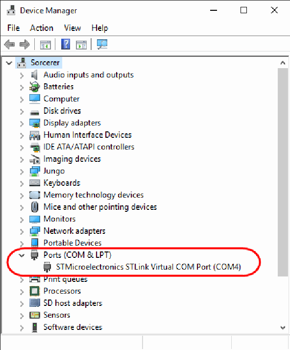
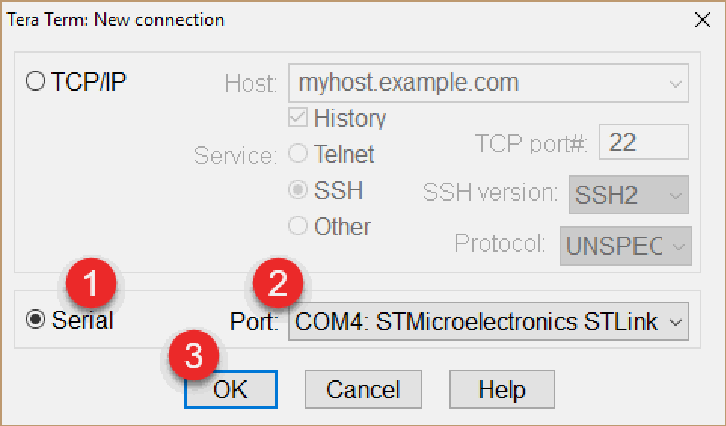
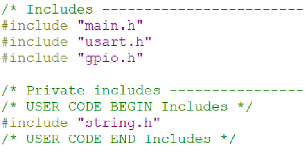

# Lab 3 — UART

**Computer Engineering International Program**  
**Department of Computer Engineering, KMITL**  
**01276314 Microcontroller Interfacing, 2026**

---

## Objectives

1. Students should be able to understand how UART works.
2. Students should be able to use UART to transmit and receive data.

---

## 1. UART / USART

USART (Universal Synchronous/Asynchronous Receiver/Transmitter) is the communication protocol that can work in both asynchronous (UART) and synchronous (USART) modes. STM32F767 microcontroller has 8 UARTs that are UART1 – UART8. However, there is no IC MAX232 on Nucleo-767ZI board so UART over RS-232 cannot be used on this board. Furthermore, ST-link IC provides the connection between the computer and microcontroller unit (MCU) called virtual com port (VCP).

Each microcontroller pin can be configured to work in 3 modes as the following:

1. Main function or after reset
2. Alternate function
3. Additional function

PB8 and PB9 pins on Nucleo-767ZI board are configured as UART3_Tx and UART3_Rx respectively and are connected to ST-link IC. As a result, MCU can communicate with the computer using virtual com port provided by ST-link IC. Pin no. 77 and 78 have the main function as PD8 and PD9 respectively but they can be configured to function as UART3 in alternate function mode as shown in Table 1.1.

**Table 1.1** — Mapping table for microcontroller pins related to UART3, UART4, and UART7.

| Main Function (After Reset) | Pin NO. | Alternate Functions | Additional Function |
|---|---|---|---|
| PF6 | 18 | TIM10_CH1, SPI5_NSS, SAI1_SD_B, **UART7_RX**, QUADSPI_BK1_IO3, ADC3_IN4 | EVENTOUT |
| PF7 | 19 | TIM11_CH1, SPI5_SCK, SAI1_MCLK_B, **UART7_TX**, ADC3_IN5, QUADSPI_BK1_IO2 | EVENTOUT |
| PA0 | 34 | TIM2_CH1/TIM2_ETR, TIM5_CH1, TIM8_ETR, USART2_CTS, ADC1_IN0, ADC2_IN0, **UART4_TX**, SAI2_SD_B, ADC3_IN0, WKUP1, ETH_MII_CRS | EVENTOUT |
| PA1 | 35 | TIM2_CH2, TIM5_CH2, USART2_RTS, ADC1_IN1, ADC2_IN1, **UART4_RX**, QUADSPI_BK1_IO3, ADC3_IN1, SAI2_MCLK_B, ETH_MII_RX_CLK/ETH_RMII_REF_CLK, LCD_R2 | EVENTOUT |
| PD8 | 77 | DFSDM1_CKIN3, **USART3_TX**, SPDIF_RX1, FMC_D13 | EVENTOUT |
| PD9 | 78 | DFSDM1_DATIN3, **USART3_RX**, FMC_D14 | EVENTOUT |

---

## 2. UART Configuration

UART3 can be used to communicate with the computer by VCP provided by ST-link. PD8 and PD9 pins connected to ST-link IC can be configured in STM32CubeMX to function as UART3_Tx and UART3_Rx respectively as shown in Fig 2.1 and Fig 2.2.



*Fig 2.1 — Shows UART3 configuration on PD8 and PD9 pins.*



*Fig 2.2 — Shows GPIO configuration for UART3 on PD8 and PD9 pins.*

---

## 3. Explanation

Before using UART, it must be configured as the following:

- **Baud rate** e.g. 115200, 57600, or 38400 Bits/sec
- **Number of data bits** including parity bit
- **Number of stop bits**
- **Parity options** which are even, odd, or no parity
- **Data direction** such as Receive and Transmit

Then PD8 and PD9 pins need to be configured to work as UART3_TX and UART3_RX respectively by configuring alternate function for both pins in GPIO setting.

There are 3 files involving UART configuration generated from STM32CubeMX as the following:

- `usart.c`
- `gpio.c`
- `main.c`

### File `usart.c`

Contains both UART and GPIO configuration.

#### Global variable `huart3`

- Declare variable that can be used to access UART3 module as shown in Fig 3.1.

```c
UART_HandleTypeDef huart3;
```

- Allow variable `huart3` to be used in other files e.g. `main.c` by declaring variable using `extern` keyword in file `usart.h`.

```c
extern UART_HandleTypeDef huart3;
```

#### Function `MX_USART2_UART_Init()`

- Is created from STM32CubeMX to configure UART3 according to user setting as shown in Fig 3.1.
- First, assign variable `huart3` to represent USART3.

```c
huart3.Instance = USART3;
```

- Then configure USART as the following:
  - Baud rate = 115,200 bits/second
  - Use 8 data bits
  - Use 1 stop bit
  - No Parity bit
  - Use both transmitting and receiving
  - No Hardware Flow Control
  - Oversampling 16 times

```c
huart3.Init.BaudRate = 115200;
huart3.Init.WordLength = UART_WORDLENGTH_8B;
huart3.Init.StopBits = UART_STOPBITS_1;
huart3.Init.Parity = UART_PARITY_NONE;
huart3.Init.Mode = UART_MODE_TX_RX;
huart3.Init.HwFlowCtl = UART_HWCONTROL_NONE;
huart3.Init.OverSampling = UART_OVERSAMPLING_16;
HAL_UART_Init(&huart3);
```



*Fig 3.1 — UART3 configuration function.*

#### Function `HAL_UART_MspInit()`

- Is used to configure PD8 and PD9 to function as UART transmit and receive pins as shown in Fig 3.2.
- Configure UART3 by enabling clock signal to UART and GPIOD modules.

```c
__HAL_RCC_USART3_CLK_ENABLE();
__HAL_RCC_GPIOD_CLK_ENABLE();
```

- Configure PD8 and PD9 to function as UART by configure them to be push-pull alternate function, no use of internal resistor, and use very high speed.

```c
GPIO_InitStruct.Pin = GPIO_PIN_8|GPIO_PIN_9;
GPIO_InitStruct.Mode = GPIO_MODE_AF_PP;
GPIO_InitStruct.Pull = GPIO_NOPULL;
GPIO_InitStruct.Speed = GPIO_SPEED_FREQ_VERY_HIGH;
GPIO_InitStruct.Alternate = GPIO_AF7_USART3;
HAL_GPIO_Init(GPIOD, &GPIO_InitStruct);
```

### File `gpio.c`

#### Function `MX_GPIO_Init()`

- Generated from STM32CubeMX to enable clock signal to GPIOD.

```c
__HAL_GPIOD_CLK_ENABLE();
```



*Fig 3.2 — PD8 and PD9 GPIO configuration function for UART3.*

### File `main.c`

#### Function `main()`

- Initialize MCU by the following functions:
  - `HAL_Init()`
  - `SystemClock_Config()`
  - `MX_GPIO_Init()`
  - `MX_USART3_UART_Init()`

---

## 4. Transmitting and Receiving Data Using UART

UART status must to be checked before use it to transmit and receive data. For data transmitting, the transmission complete (TC) flag from UART status register must be logic 1 to indicate that the previous transmission has been completed. In addition, the read data register not empty (RXNE) flag should be logic 1 when reading data from UART receiving buffer or receive data register.

### Macro `__HAL_UART_GET_FLAG(__HANDLE__, __FLAG__)`

- Is used to read status flag from UART status register.
- `__HANDLE__`: specify the desired UART e.g. `&huart3`.
- `__FLAG__`: specify desired UART flag e.g. `UART_FLAG_RXNE` and `UART_FLAG_TC`.

### Function `HAL_UART_Transmit()`

```c
HAL_StatusTypeDef HAL_UART_Transmit(UART_HandleTypeDef *huart,
    uint8_t *pData, uint16_t Size, uint32_t Timeout)
```

- Is used to transmit data by UART.
- `huart`: specify desired UART for transmitting data e.g. `&huart3`.
- `pData`: specify the starting address of transmitting data by pointer variable.
- `Size`: specify the size of transmitting data in bytes.
- `Timeout`: allotted time for function to execute in millisecond.
- If the transmission success, this function will return `HAL_OK`. Otherwise, it will return `HAL_TIMEOUT`, `HAL_BUSY`, or `HAL_ERROR`.

```c
char str[] = "Hello, World!!\r\n";
while(__HAL_UART_GET_FLAG(&huart3,UART_FLAG_TC)==RESET){}
HAL_UART_Transmit(&huart3, (uint8_t*) str, strlen(str),1000);
HAL_Delay(500);
```

*Fig 4.1 — The example code for UART Transmission*

Fig 4.1 shows a string transmission by UART. A string is stored in variable `str` and the string ends with 2 non printable characters that are the carriage return or `'\r'` and the line feed or `'\n'`. The carriage return moves the cursor back to the beginning of the current line and the line feed moves the cursor to the next line at the same position. TC flag must be set before function `HAL_UART_Transmit()` is called. This is done by placing the while loop before the function `HAL_UART_Transmit()`.

### Function `HAL_UART_Receive()`

```c
HAL_StatusTypeDef HAL_UART_Receive (UART_HandleTypeDef *huart,
    uint8_t *pData, uint16_t Size, uint32_t Timeout)
```

- Is used to receive data by UART.
- `huart`: specify desired UART for receiving data e.g. `&huart3`.
- `pData`: specify the starting address of variable used to store receiving data.
- `Size`: specify the size of receiving data in bytes.
- `Timeout`: allotted time for function to execute in millisecond.
- If the transmission success, this function will return `HAL_OK`. Otherwise, it will return `HAL_TIMEOUT`, `HAL_BUSY`, or `HAL_ERROR`.

```c
char ch1;
while(__HAL_UART_GET_FLAG(&huart3,UART_FLAG_RXNE)== RESET){}
HAL_UART_Receive(&huart3, (uint8_t*) &ch1, 1, 1000);
```

*Fig 4.2 — The example code for UART Receive*

---

## 5. TeraTerm

TeraTerm is the terminal emulator that allows communication between MCU and the computer. When MCU transmits data via UART to the computer, TeraTerm receives and displays data inside the program. When the user presses the keyboard on TeraTerm, ASCII code of that character is sent to MCU via VCP on the computer.

- **Download** TeraTerm on the following URL and then install:  
  <https://github.com/TeraTermProject/teraterm/releases>
- **Open** the program and setup serial port by selecting menu **File → Setup → Serial Port**.
- Use the same configuration from UART as shown in Fig 5.1.
- Use the COM port number that displays in Device manager as shown in Fig 5.2.
- **Start** connecting the computer and microcontroller unit by selecting menu **File → New connection** and select the desired COM port as shown in Fig 5.3.
- **Disconnect** by selecting menu **File → Disconnect**.
- **Clear screen** by selecting menu **Edit → Clear screen**.



*Fig 5.1 — Setup serial port in TeraTerm.*



*Fig 5.2 — Shows COM Port number in Device Manager.*



*Fig 5.3 — Start the connection between the computer and microcontroller unit.*

---

## 6. Experiment

### Experiment 1

Write the code that transmits and receives data via UART3. First, configure UART3 in STM32CubeMX as shown in Fig 2.1 and Fig 2.2. Then write the code as shown in Fig 4.1 inside the infinite loop in `main()` function. This code transmits string `"Hello World!!"` to display in TeraTerm program on the computer.

The function `strlen()` is used to find the length of the string and this function belongs to `string.h` library. The compiler needs to be informed about the library used in the file, this can be done by `#include` directive as shown in Fig 6.1.



*Fig 6.1 — Include `string.h` library in `main.c` file.*

### Experiment 2

Write the code to transmit a character via UART3:

```c
char ch1 = 'A';
```

### Experiment 3

Write the code to display the following string in TeraTerm:

```
Input =>
```

Then waiting for the user to input 1 character by the keyboard. The input character will be transmitted automatically to MCU. After that, MCU transmits the same character back to display in TeraTerm and also displays string `Input =>` again and waits for the new input. This process is repeated until the user inputs character `'q'` resulted in MCU displays `"QUIT"` and stop responding (stop transmitting and receiving data) as shown in Fig 6.2.

```
Input => a
Input => 1
Input => D
Input => q
QUIT
```

*Fig 6.2 — Shows the example result for Experiment 3 from TeraTerm.*

### Experiment 4

Connect 2 LEDs labelled as LED1 and LED2 to the desired microcontroller pins. MCU displays user menu in TeraTerm as shown in Fig 6.3.

```
Display Blinking LED PRESS (1, 2)
Display Group Members PRESS m
Quit PRESS q
Input =>
```

*Fig 6.3 — Shows user menu from TeraTerm*

Then waiting for the user to input 1 character from TeraTerm and MCU perform specific tasks according to the input character as shown in Table 6.1. After that, MCU displays only line `Input =>` and waits for the new input character.

**Table 6.1 — Shows microcontroller tasks for Experiment 4.**

| Input Character | Microcontroller Tasks |
|---|---|
| **1** | Blink LED1 3 times. Set delay time for 300 ms. |
| **2** | Blink LED2 3 times. Set delay time for 300 ms. |
| **m** | Display student ID and full name of everyone in the lab group e.g.:<br>`63xxxxxx First1 Last1`<br>`63xxxxxx First2 Last2` |
| **q** | Microcontroller displays `Quit` and stops responding. |
| **Others** | Microcontroller displays `Unknown Command` and waits for the new input. |

---

## Lab 3 Submission

**Microcontroller Interfacing 2026**

Date \_\_\_\_\_\_\_\_\_\_\_\_\_\_\_\_\_\_\_\_\_\_\_\_\_\_ Lab Group No. \_\_\_\_\_\_\_\_

1. Student ID \_\_\_\_\_\_\_\_\_\_\_\_\_\_\_\_\_\_\_\_\_\_ Name \_\_\_\_\_\_\_\_\_\_\_\_\_\_\_\_\_\_\_\_\_\_\_\_\_\_\_\_\_\_\_\_\_\_\_\_\_
2. Student ID \_\_\_\_\_\_\_\_\_\_\_\_\_\_\_\_\_\_\_\_\_\_ Name \_\_\_\_\_\_\_\_\_\_\_\_\_\_\_\_\_\_\_\_\_\_\_\_\_\_\_\_\_\_\_\_\_\_\_\_\_
3. Student ID \_\_\_\_\_\_\_\_\_\_\_\_\_\_\_\_\_\_\_\_\_\_ Name \_\_\_\_\_\_\_\_\_\_\_\_\_\_\_\_\_\_\_\_\_\_\_\_\_\_\_\_\_\_\_\_\_\_\_\_\_

### Checkpoints

1. Experiment 1-3
2. Experiment 4

### Questions

1. If the following statement is omitted from the code in Fig 4.1, will it have the same result? Why?
   ```c
   while(__HAL_UART_GET_FLAG(&huart3,UART_FLAG_TC)==RESET){}
   ```

2. If the following statement is omitted from the code in Fig 4.2, will it have the same result? Why?
   ```c
   while(__HAL_UART_GET_FLAG(&huart3,UART_FLAG_RXNE)== RESET){}
   ```
