# 01276314 Microcontroller Interfacing, 2026 — Lab 5: ADC

Computer Engineering International Program · Department of Computer Engineering, KMITL

---

## Page 1

**Lab 5 ADC**

**Objectives**

1. Students should be able to understand analog to digital converter.
2. Students should be able to program analog to digital converter.

### 1. Analog to Digital Converter (ADC)

The STM32F767 microcontroller has 3 analog-to-digital converters which are ADC1, ADC2, and ADC3 connected to the APB2 bus. The structure of ADC is the successive approximation which has the 12-bit resolution. The ADC has 19-multiplexed channels which are 16 external channels (channel 0 – 15), unused channel 16, channel 17 for VREF (internal reference voltage), and channel 18 that shares between temperature sensor and VBAT. The maximum voltage of ADC is 3.6 V.

To use external ADC channels, the analog input source must be connected to the proper microcontroller pin. As shown in Fig 1.1, if the analog input is connected to PC0 pin, the analog signal can be converted by channel 10 from ADC1, ADC2, or ADC3.

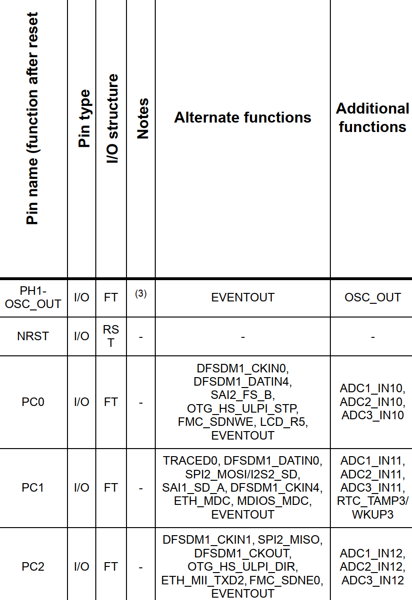

> **[Figure 1.1]** shows the association of microcontroller pins and ADC channels.

---

## Page 2

### 2. ADC configuration in STM32CubeMX

Configuring PC0 pin to function as ADC1 channel 10 as shown in Fig 2.1 and connect the voltage divider circuit to this pin. Then configuring ADC module as shown in Fig 2.2.

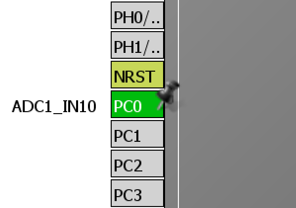

> **[Figure 2.1]** Configuring PC0 pin to function as analog input.

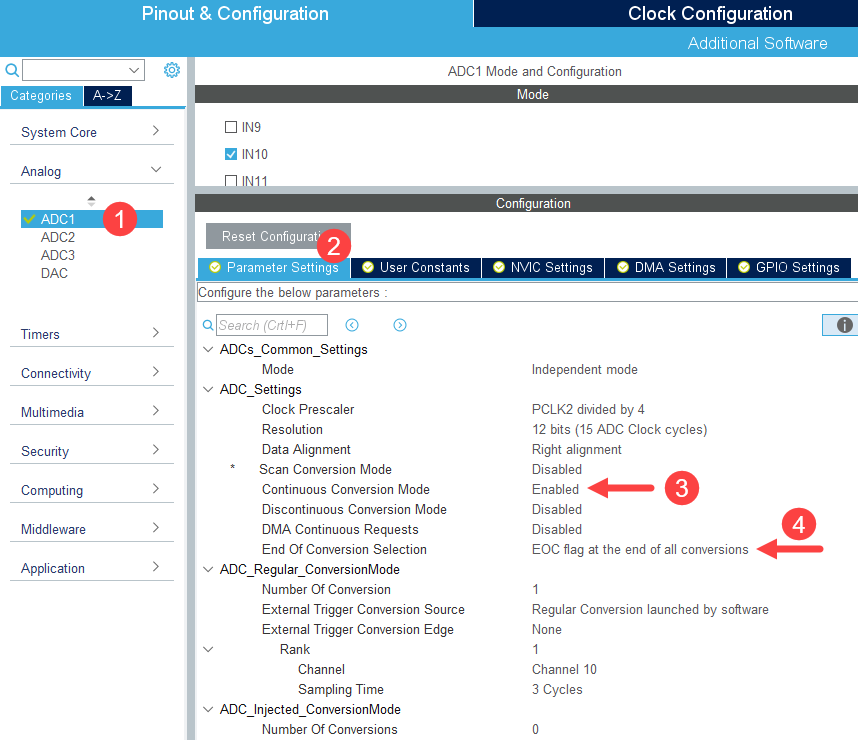

> **[Figure 2.2]** Configuring ADC module.

---

## Page 3

### 3. Explanation

STM32CubeMX configures ADC with `MX_ADC1_Init()` function in `adc.c` file as shown in Fig 3.1. ADC is configured to function as regular and right data alignment (`ADC_DATAALIGN_RIGHT`). Then enable clock signal to GPIOC in `MX_GPIO_Init()` in `gpio.c` file as shown in Fig 3.2.

In addition, PC0 pin is configured as analog input pin in `HAL_ADC_MspInit` function in `adc.c` file as shown in Fig 3.3.

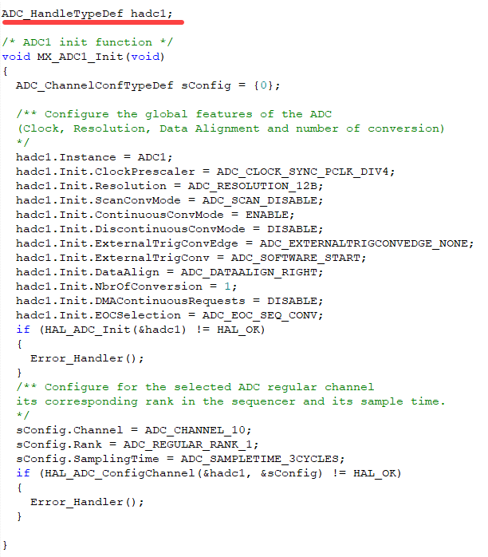

> **[Figure 3.1]** shows ADC configuration in `MX_ADC1_Init()` function.

OCR of Figure 3.1 (from image):

```c
ADC_HandleTypeDef hadc1;

/* ADC1 init function */
void MX_ADC1_Init(void)
{
  ADC_ChannelConfTypeDef sConfig = {0};

  /** Configure the global features of the ADC
      (Clock, Resolution, Data Alignment and number of conversion)
  */
  hadc1.Instance = ADC1;
  hadc1.Init.ClockPrescaler = ADC_CLOCK_SYNC_PCLK_DIV4;
  hadc1.Init.Resolution = ADC_RESOLUTION_12B;
  hadc1.Init.ScanConvMode = ADC_SCAN_DISABLE;
  hadc1.Init.ContinuousConvMode = ENABLE;
  hadc1.Init.DiscontinuousConvMode = DISABLE;
  hadc1.Init.ExternalTrigConvEdge = ADC_EXTERNALTRIGCONVEDGE_NONE;
  hadc1.Init.ExternalTrigConv = ADC_SOFTWARE_START;
  hadc1.Init.DataAlign = ADC_DATAALIGN_RIGHT;
  hadc1.Init.NbrOfConversion = 1;
  hadc1.Init.DMAContinuousRequests = DISABLE;
  hadc1.Init.EOCSelection = ADC_EOC_SEQ_CONV;
  if (HAL_ADC_Init(&hadc1) != HAL_OK)
  {
    Error_Handler();
  }
  /** Configure for the selected ADC regular channel
      its corresponding rank in the sequencer and its sample time.
  */
  sConfig.Channel = ADC_CHANNEL_10;
  sConfig.Rank = ADC_REGULAR_RANK_1;
  sConfig.SamplingTime = ADC_SAMPLETIME_3CYCLES;
  if (HAL_ADC_ConfigChannel(&hadc1, &sConfig) != HAL_OK)
  {
    Error_Handler();
  }
}
```

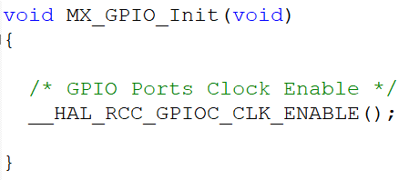

> **[Figure 3.2]** shows enabling clock signal to GPIOC in `MX_GPIO_Init()` function.

OCR of Figure 3.2 (from image):

```c
void MX_GPIO_Init(void)
{
  /* GPIO Ports Clock Enable */
  __HAL_RCC_GPIOC_CLK_ENABLE();
}
```

---

## Page 4

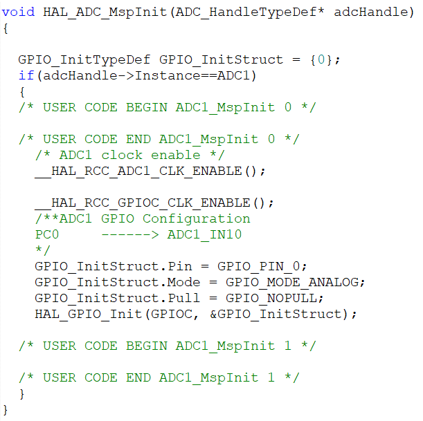

> **[Figure 3.3]** shows PC0 configuration to function as analog input.

OCR of Figure 3.3 (from image):

```c
void HAL_ADC_MspInit(ADC_HandleTypeDef* adcHandle)
{
  GPIO_InitTypeDef GPIO_InitStruct = {0};
  if (adcHandle->Instance == ADC1)
  {
    /* USER CODE BEGIN ADC1_MspInit 0 */

    /* USER CODE END ADC1_MspInit 0 */
    /* ADC1 clock enable */
    __HAL_RCC_ADC1_CLK_ENABLE();
    __HAL_RCC_GPIOC_CLK_ENABLE();

    /**ADC1 GPIO Configuration
        PC0     ------> ADC1_IN10
    */
    GPIO_InitStruct.Pin = GPIO_PIN_0;
    GPIO_InitStruct.Mode = GPIO_MODE_ANALOG;
    GPIO_InitStruct.Pull = GPIO_NOPULL;
    HAL_GPIO_Init(GPIOC, &GPIO_InitStruct);

    /* USER CODE BEGIN ADC1_MspInit 1 */

    /* USER CODE END ADC1_MspInit 1 */
  }
}
```

### 4. Reading ADC Value by Polling

Using `HAL_ADC_GetValue()` function to read converted digital value from ADC. It returns 32-bit unsigned integer or `uint32_t` as shown as Fig 4.1.

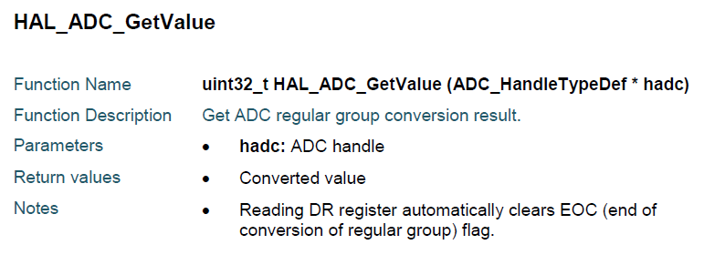

> **[Figure 4.1]** shows the detail of `HAL_ADC_GetValue` function.

The `HAL_ADC_GetValue()` function can be called after ADC completes the conversion. This can be done by invoking `HAL_ADC_PollForConversion()` function. This function returns `HAL_OK` when ADC completes the conversion. Fig 4.2 shows the example for reading ADC value and the 100 value is the timeout for this function.

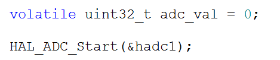

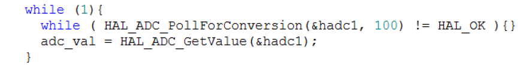

> **[Figure 4.2]** shows how to read converted data from ADC.

OCR of Figure 4.2 (from image):

```c
volatile uint32_t adc_val = 0;
HAL_ADC_Start(&hadc1);

while (1) {
  while (HAL_ADC_PollForConversion(&hadc1, 100) != HAL_OK) {}
  adc_val = HAL_ADC_GetValue(&hadc1);
}
```

---

## Page 5

### 5. Reading Multichannel ADC Values with DMA

Reading ADC values from several channels simultaneously can be done. First, the reading order must be set however multichannel ADC reading is difficult to achieve by polling. While reading each channel, microcontroller may have other tasks to complete also. If the ADC value is replaced before being read, this will cause overrun which leads to HardFault exception.

Direct Memory Access Controller (DMA) is the module that controls the data transferring without processor core involvement. For example, if there is the need to transfer the data from the peripheral to the memory, DMA can handle the task after it is set by the processor core. So, the processor core will be available for any other tasks.

Further study how to read values from multichannel ADC using DMA from the lecture slides.

### 6. Reducing the swing of ADC value

Normally, the values obtained from ADC can swing as show in Fig 6.1. Using average value from current and previous values can reduce the effect of the swing as shown in Fig 6.2 which compares current ADC value with 2 average values. The orange line averages values from current and 7 previous values and the blue line averages values from current and 15 previous values. As a result, the effect of the swing data can be reduced.

The code for `average_8` and `average_16` function can be shown in Fig 6.3. Both functions use static local variables to store the previous ADC values used to average ADC values because static variable will not be destroyed after completing function execution. The current ADC value is circularly stored in array `samples`.

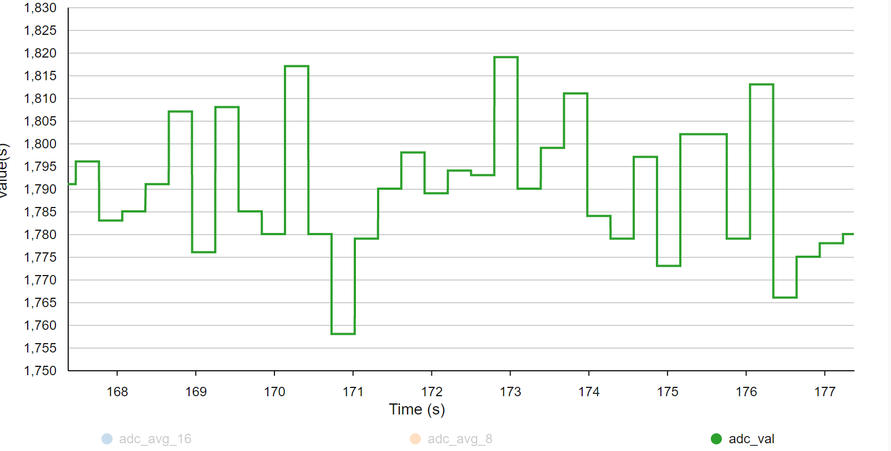

> **[Figure 6.1]** shows the swing of ADC value.

---

## Page 6

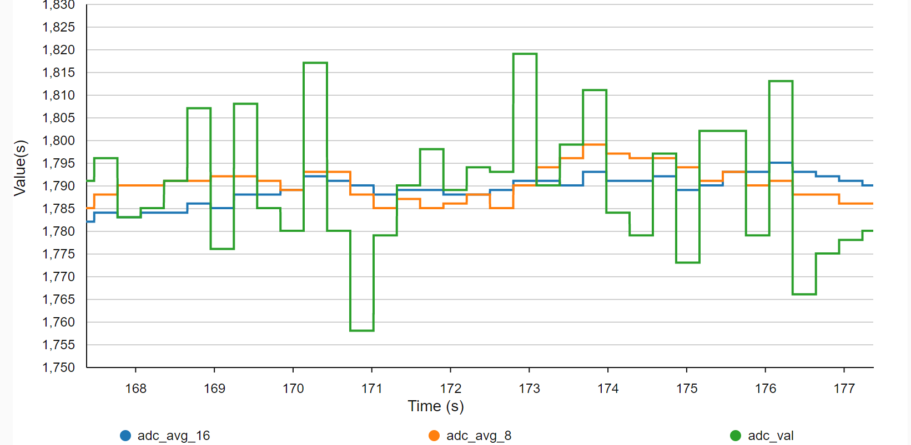

> **[Figure 6.2]** compares single ADC value with average of 8 and 16 values.

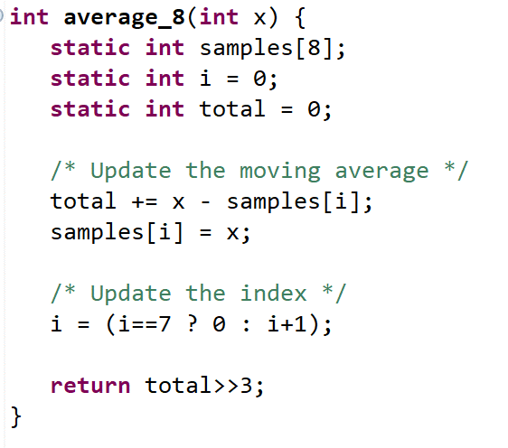

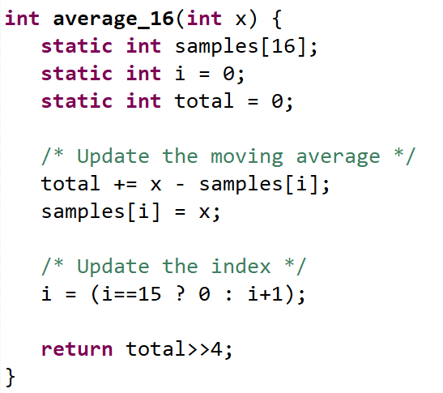

> **[Figure 6.3]** shows the code for `average_8` and `average_16` functions.

OCR of Figure 6.3 (from image):

```c
int average_8(int x) {
  static int samples[8];
  static int i = 0;
  static int total = 0;

  /* Update the moving average */
  total += x - samples[i];
  samples[i] = x;

  /* Update the index */
  i = (i == 7 ? 0 : i + 1);

  return total >> 3;
}
```

```c
int average_16(int x) {
  static int samples[16];
  static int i = 0;
  static int total = 0;

  /* Update the moving average */
  total += x - samples[i];
  samples[i] = x;

  /* Update the index */
  i = (i == 15 ? 0 : i + 1);

  return total >> 4;
}
```

---

## Page 7

### 7. Experiment

#### 1. Show the unsigned integer in hexadecimal using UART3

Create `displayHEX` function that has function prototype as the following:

```c
void displayHEX(uint32_t);
```

This function displays the received 32-bit unsigned integer in 8-digit hexadecimal format using UART3 as shown by the following:

```c
uint32_t hex1 = 501;
displayHEX(hex1);
```

The function displays `0x000001F5` by UART3.

The `sprintf` function from `stdio.h` can be used to display the integer in hexadecimal.

#### 2. The voltage divider circuit with the potentiometer

Build the voltage divider circuit with the potentiometer to Nucleo-F767 board as shown in Fig 7.1. This circuit will be used later to experiment with ADC.

- Pin 1 connects to ground pin
- Pin 2 connects to PC0 pin.
- Pin 3 connects to VDD (3.3 V).

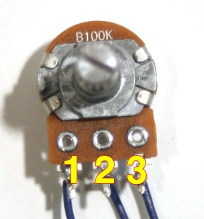

> **[Figure 7.1]** shows the connectivity of the potentiometer.

#### 3. Reading ADC Value

After building the circuit from Experiment 2, use STM32CubeMX to create new project. Configure PC0 pin to function as the analog input pin as shown in Fig 2.1 and Fig 2.2. Then write the code for reading ADC value as shown in Fig 4.2 in main function. Display the reading value in TeraTerm using `displayHEX` function but modify the function to also show ADC channel and the voltage (2 decimal places) calculated from the reading value using 400-ms delay time. Rotate the potentiometer, notice, and answer the following questions.

---

## Page 8

Display example: `ADC1_CH10 0x000001F5 Vin = 0.40 V`

- The minimum of ADC value is
- The maximum of ADC value is
- Why the maximum of ADC value is not `0xFFFFFFFF`?

#### 4. Reduce the swing effect using average function

Reduce the swing effect from ADC values by implementing `average_8` and `average_16` function as shown in Fig 6.3. First, declare 2 global variables that are `adc_avg_8` and `adc_avg_16` to store the result from both functions. Show the comparison graph in STM32CubeMonitor as shown in Fig 6.2.

#### 5. Display ADC value range using LEDs

Write the code that display ADC value range with 4 LEDs. Any GPIO pin can be used. Divide the ADC values in 5 ranges. When the current ADC value falls into one of the ranges, LEDs will glow as shown in Table 7.1. In addition, keeping the display from Experiment 3.

**Table 7.1** shows the associated LEDs that glow in each level.

| Range | Result                        |
|-------|-------------------------------|
| 1     | No LED glows                  |
| 2     | LED0 glows                    |
| 3     | LED0 & LED1 glow              |
| 4     | LED0, LED1, & LED2 glow       |
| 5     | LED0, LED1, LED2, & LED3 glow |

**Record the result**

| Range | ADC Value Range |
|-------|-----------------|
| 1     |                 |
| 2     |                 |
| 3     |                 |
| 4     |                 |
| 5     |                 |

---

## Page 9

### Special Problem 1 — Multichannel ADC with DMA

Build 2 voltage divider circuits using 2 potentiometers but connect each potentiometer to 4 channels of ADC1. Display ADC values using UART3. Use DMA to transfer ADC values. After transferring the first half, LD2 LED is on. After transferring the second half, LD2 LED is off.

Any ADC1 pin can be used except pins that has already been used (blue labels on mbed website) such as PA7 pin. The delay time, the ADC frequency, and the sampling time can be adjusted.

---

## Page 10

### Lab 5 Submission

*Microcontroller Interfacing 2026*

Date **\_\_\_\_\_\_\_\_\_\_\_\_\_\_\_\_\_\_\_**  Lab Group No. **\_\_\_\_\_\_\_\_\_\_\_\_**

1. Student ID **\_\_\_\_\_\_\_\_\_\_** Name **\_\_\_\_\_\_\_\_\_\_\_\_\_\_\_\_\_\_\_\_\_\_\_\_** 
2. Student ID **\_\_\_\_\_\_\_\_\_\_** Name **\_\_\_\_\_\_\_\_\_\_\_\_\_\_\_\_\_\_\_\_\_\_\_\_** 
3. Student ID **\_\_\_\_\_\_\_\_\_\_** Name **\_\_\_\_\_\_\_\_\_\_\_\_\_\_\_\_\_\_\_\_\_\_\_\_** 

**Checkpoints**

- Experiment 3&4
- Experiment 5

**Questions**

1. Which microcontroller pin can function as channel 1 of ADC2?
2. From Experiment 5, if changing the data alignment to left alignment, adjusting the 5 ranges to produce the same the result.

| Range | ADC Value Range (From Experiment 5) | ADC Value Range (Left Alignment Configuration) |
|-------|-------------------------------------|------------------------------------------------|
| 1     |                                     |                                                |
| 2     |                                     |                                                |
| 3     |                                     |                                                |
| 4     |                                     |                                                |
| 5     |                                     |                                                |
