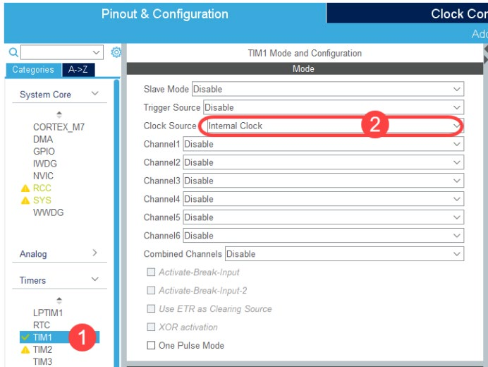
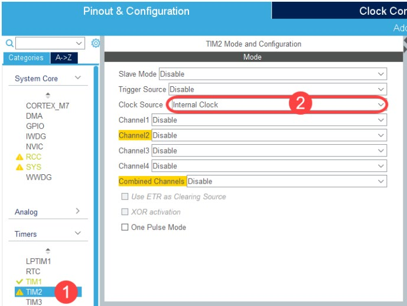
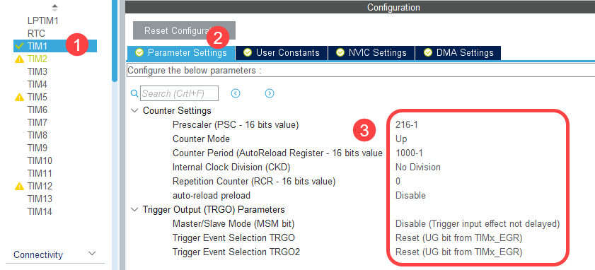
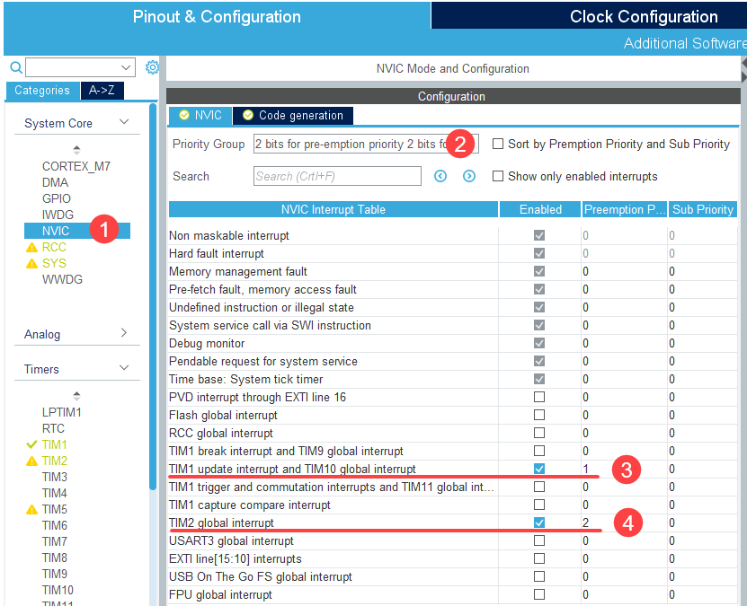
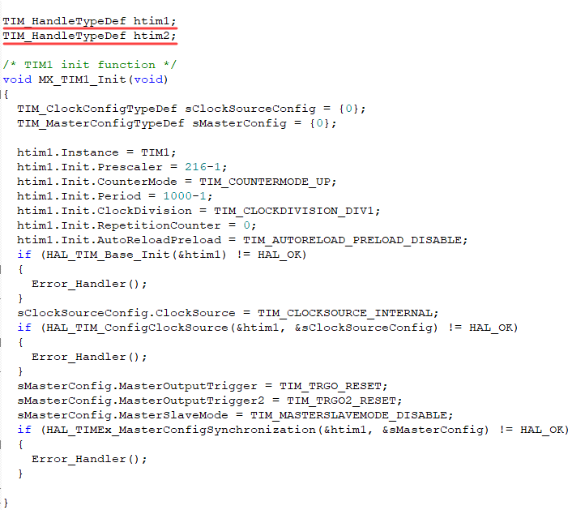
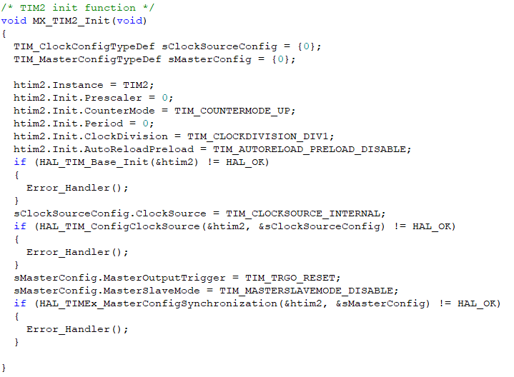
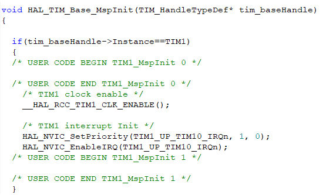
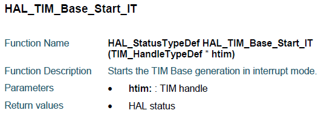
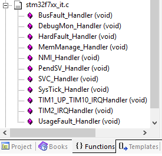

# 01276314 Microcontroller Interfacing, 2026 — Lab 6: Timer

Computer Engineering International Program · Department of Computer Engineering, KMITL

---

## Page 1

**Lab 6 Timer**

**Objectives**

1. Students should be able to understand how the timer works.
2. Students should be able to program the timer.

### 1. Timer

The STM32F767 has 18 timers which have TIM1 and TIM8 as the advanced-control timers and TIM2 – TIM5 as general-purpose timers etc. In general, each timer has the following properties:

- A 16- or 32-bit counter.
- A 16-bit prescaler.
- Generate the interrupt signal when timer is complete counting.
- The timer has the maximum of 4 independent channels which can be used in 4 modes. Those modes are input capture, output capture, PWM (pulse width modulation generation), and one pulse mode output.

Generally, timer counter can be configured to count up or count down. Each timer connects to different buses so it works with different clock frequencies as shown in Table 1.1.

**Table 1.1** shows the connection between timers and APB.

| Bus  | MAX Bus Frequency (MHz) | MAX Timer Frequency (MHz) | Module                                       |
|------|-------------------------|---------------------------|----------------------------------------------|
| APB1 | 54                      | 108                       | TIM2 TIM3 TIM4 TIM5 · TIM12 TIM13 TIM14      |
| APB2 | 108                     | 216                       | TIM1 TIM8 TIM9 · TIM10 TIM11                 |

---

## Page 2

### 2. Timer Configuration in STM32CubeMX

#### 2.1 Enable timer by specifying the clock source

For example, enable TIM1 and TIM2 by specifying the clock source as internal clock as shown in Fig 2.1.





> **[Figure 2.1]** shows the configuration for (a) TIM1 and (b) TIM2.

#### 2.2 Configure the timer to count for a specified duration

Then configure the timer to count for the specified duration by configuring the prescaler, counter mode, and counter period with the following calculation.

```
Time Interval = (Clock Division x Prescaler x Period) / Timer Clock Frequency
```

For example, if TIM1 is used to count for 1 ms, it must be configured as shown in Fig 2.2 and the calculation can be shown as the following:

```
(1 x 216 x 1000) / 216 MHz           = 1 ms
```

Notice that the values of prescaler and counter period are subtracted from the above calculation by 1. Prescaler counter and counter period of TIM1 are 16 bits wide and the value of clock division can be 1, 2, or 4.



> **[Figure 2.2]** shows TIM1 configuration to count for 1-ms duration.

---

## Page 3

#### 2.3 Configure the timer interrupt priority

After the timer counts to the specified duration, the timer interrupt signal will be generated. Therefore, the priority of the timer interrupt must also be configured. The TIM1 is the advanced-control timer so it has several interrupt signals for different events. TIM1 interrupt generated after finish counting is called TIM1 Update Interrupt. However, TIM2 is the general purpose timer which has only 1 interrupt signal called TIM2 Global Interrupt. Timer interrupt priority can be configured under NVIC in STM32CubeMX as shown in Fig 2.3.



> **[Figure 2.3]** shows NVIC configuration for timer interrupt.

### 3. Explanation

`MX_TIM1_Init` and `MX_TIM2_Init` functions in `tim.c` file are generated from STM32CubeMX to configure TIM1 and TIM2 as shown in Fig 3.1 and Fig 3.2 respectively. Since the timer is configured to be neither an input nor an output, there is no configuration in `MX_GPIO_Init` function.

**Function `MX_TIM1_Init`**

- Generated from STM32CubeMX to configure TIM1.
- First, declare `htim1` global variable in `tim.c` file to be used to access TIM1.

```c
TIM_HandleTypeDef htim1;
```

- Inside function, declare 2 local variables used to configure TIM1.

```c
TIM_ClockConfigTypeDef sClockSourceConfig;
TIM_MasterConfigTypeDef sMasterConfig;
```

- Then configure clock division value for TIM1.

```c
htim1.Init.ClockDivision = TIM_CLOCKDIVISION_DIV1;
```

- Configure prescaler value as 215 (216-1) to divide clock frequency.

---

## Page 4

```c
htim1.Init.Prescaler = 216-1;
```

- Configure period value as 999 (1000-1).

```c
htim1.Init.Period = 1000-1;
```

- Configure TIM1 to count up mode.

```c
htim1.Init.CounterMode = TIM_COUNTERMODE_UP;
```



> **[Figure 3.1]** shows TIM1 configuration in `MX_TIM1_Init()` function.



> **[Figure 3.2]** shows TIM2 configuration in `MX_TIM2_Init()` function.

**Function `HAL_TIM_Base_MspInit`**

---

## Page 5

- Generated from STM32CubeMX in `tim.c` file to configure the priority for timer interrupt signals as shown in Fig 3.3.



> **[Figure 3.3]** shows the interrupt priority configuration for TIM1.

### 4. Interrupt Service Routine of Timer

The timer starts counting when `HAL_TIM_Base_Start_IT` function is invoked and generates the interrupt signal when finish counting such as

- `HAL_TIM_Base_Start_IT(&htim1)`
- `HAL_TIM_Base_Start_IT(&htim2)`

The detail of `HAL_TIM_Base_Start_IT` function can be shown in Fig 4.1.



> **[Figure 4.1]** shows the detail of `HAL_TIM_Base_Start_IT` functions.

The interrupt service routine (ISR) of the timer according to the configuration in Fig 2.3. `TIM1_UP_TIM10_IRQHandler` and `TIM2_IRQHandler` functions in `stm32f7xx_it.c` file for TIM1 and TIM2 respectively as shown in Fig 4.2.

---

## Page 6



> **[Figure 4.2]** shows the interrupt service routine of TIM1 and TIM2.

---

## Page 7

### 5. Experiment

#### 1. TIM1 and TIM1 ISR

Create a STM32 project from Board Selector tab instead of MCU/MPU Selector tab. Then write the program that increase 32-bit unsigned integer variable by 1 every 1 ms using TIM1 and show the value of this variable every 400 ms via UART3.

- Configure TIM1 to count 1 ms according to Fig 2.1, Fig 2.2, and Fig 2.3.
- Declare global variable `uint32_t count` in `main.c` file and declare this variable again in `stm32f7xx_it.c` file but this time uses `extern` keyword in front of the declaration.
- In the `TIM1_UP_TIM10_IRQHandler` function which is ISR of TIM1 write the code that increase `count` variable by 1 (`count++`).
- Start TIM1 by invoking `HAL_TIM_Base_Start_IT(&htim1)` function before the infinite loop.
- Implement `displayNumber` function in `main.c` file that receives 32-bit unsigned integer and displays that number in decimal via UART3.
- Invoke `displayNumber(count)` function and `HAL_Delay(400)` within the infinite loop in main function.

---

## Page 8

#### 2. Use TIM1 and TIM2 to display the time by UART3

Write a program to display the time in min:sec (MM:SS) format via UART3. The display time must have the same pace as the real clock. When display by UART3, end the string with only carriage return (`'\r'`) so the time will be repeatedly display on the same line.

Display the time every 400 ms but using TIM2 instead of `HAL_Delay` function. Record TIM2 configuration and show the calculation.

When submitting, compare the timer against a real clock. For the timer, measure the elapsed time for at least 7 minutes. The timing error must not exceed 2 seconds. For interrupt handling, use only an interrupt service routine. Do not use callback functions.

**Record TIM2 configuration and calculation**

| Item               | Value |
|--------------------|-------|
| TIM2 time interval |       |
| clock division     |       |
| Prescaler          |       |
| Period             |       |
| Calculation        |       |

---

## Page 9

### Lab 6 Submission

*Microcontroller Interfacing 2026*

Date **\_\_\_\_\_\_\_\_\_\_\_\_\_\_\_\_\_\_\_**  Lab Group No. **\_\_\_\_\_\_\_\_\_\_\_\_**

1. Student ID **\_\_\_\_\_\_\_\_\_\_** Name **\_\_\_\_\_\_\_\_\_\_\_\_\_\_\_\_\_\_\_\_\_\_\_\_**
2. Student ID **\_\_\_\_\_\_\_\_\_\_** Name **\_\_\_\_\_\_\_\_\_\_\_\_\_\_\_\_\_\_\_\_\_\_\_\_**
3. Student ID **\_\_\_\_\_\_\_\_\_\_** Name **\_\_\_\_\_\_\_\_\_\_\_\_\_\_\_\_\_\_\_\_\_\_\_\_**

**Checkpoints**

- Experiment 1
- Experiment 2

**Questions**

1. If the program that toggles LED every 500 ms uses the timer instead of `HAL_Delay` function, how will this affect the way the microcontroller executes?
