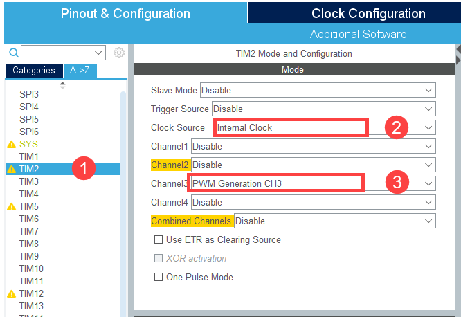
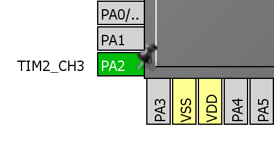
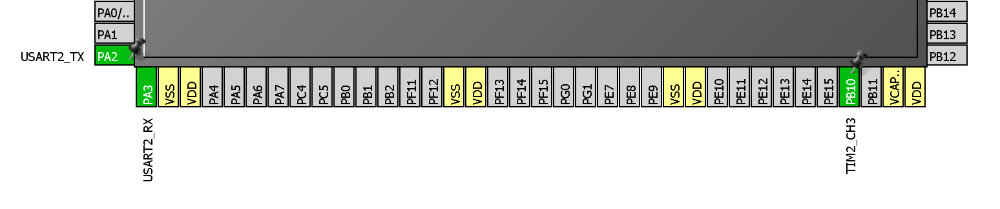
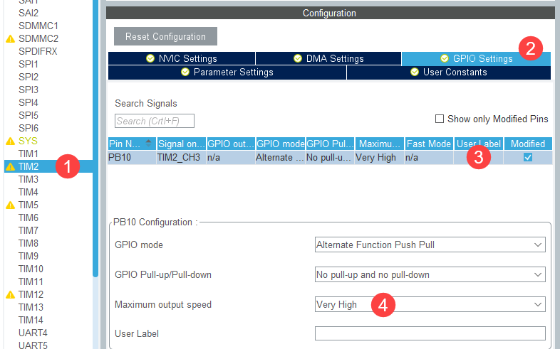
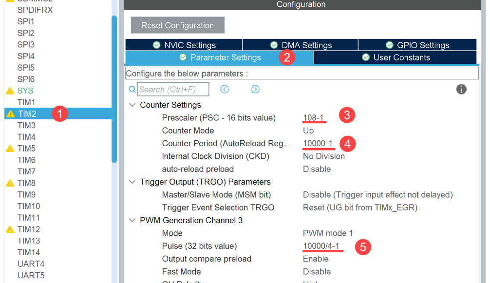
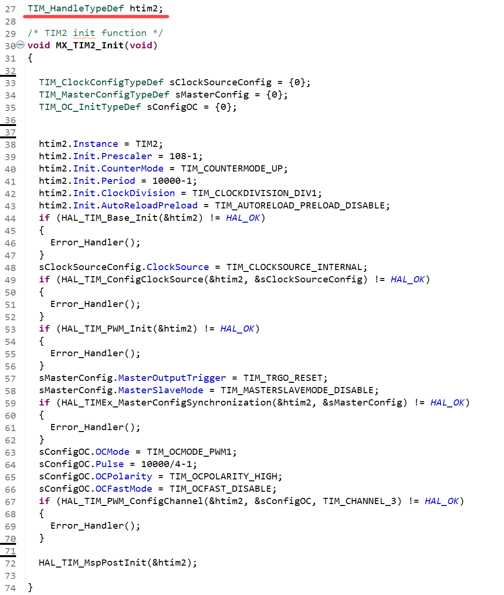
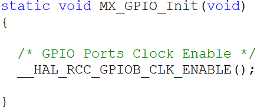
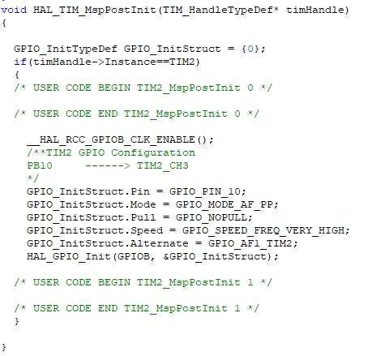
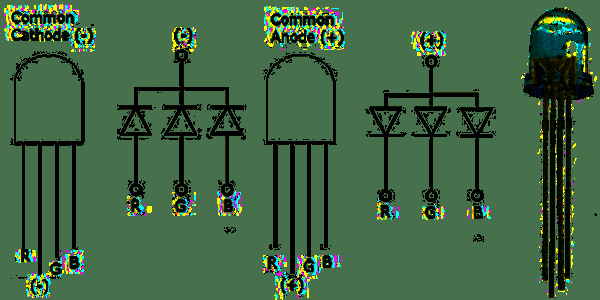
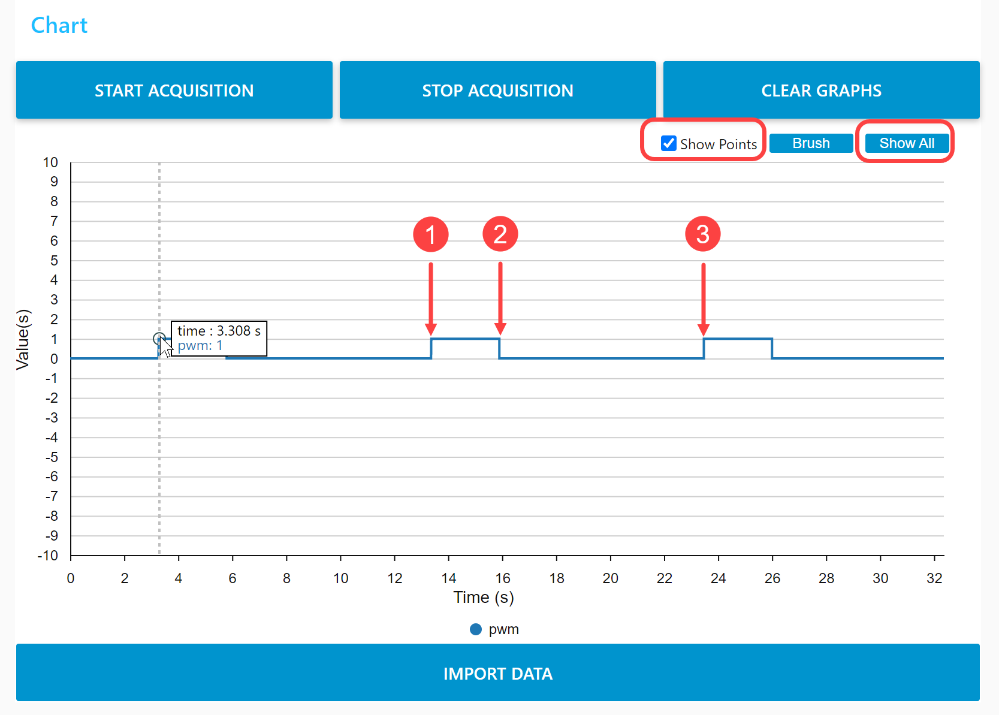

# 01276314 Microcontroller Interfacing, 2026 — Lab 7: PWM

Computer Engineering International Program · Department of Computer Engineering, KMITL

---

## Page 1

**Lab 7 Pulse-Width Modulation**

**Objectives**

1. Students should be able to understand pulse-width modulation.
2. Students should be able to use the timer to generate pulse-width modulation.

### 1. Pulse-Width Modulation Generation

The timers inside the STM32F767 microcontroller can be used to generate pulse-width modulation (PWM) that can be used to control external components such as LEDs or motors. PWM frequency is controlled by `TIMx_ARR` register and PWM duty cycle is controlled by `TIMx_CCRx` registers. PWM is generated by comparing between the counter register and the `TIMx_CCRx` registers and there are 2 modes as the following:

1. **Mode 1:** For up counting, PWM is set when timer counter is less than `TIMx_CCRx` and PWM is reset when timer counter is equal or greater than `TIMx_CCRx`.
2. **Mode 2:** For down counting, PWM is set when timer counter is greater than `TIMx_CCRx` and PWM is reset when timer counter is equal or less than `TIMx_CCRx`.

### 2. Timer Configuration in STM32CubeMX

If `TIM2_CH3` is used to generate PWM, the configuration can be shown in Fig 2.1. Then PA2 pin is configured as output pin can be shown in Fig 2.2 (a) but if PA2 pin has already been used such as used for UART2, PB10 can be used to output PWM for `TIM2_CH3` alternatively as shown in Fig 2.2 (b).



> **[Figure 2.1]** shows the configuration of TIM2 Channel 3 to generate PWM.

---

## Page 2





> **[Figure 2.2]** shows microcontroller pins that can be used to output PWM from TIM2_CH3.

After that, PB10 pin configuration is shown in Fig 2.3 and TIM2 is configured to generate PWM with a 10-ms period and 25% duty cycle as shown in Fig 2.4.



> **[Figure 2.3]** shows the configuration of PB10 pin.

---

## Page 3



> **[Figure 2.4]** shows PWM period and duty cycle configuration using TIM2 CH3.

### 3. Explanation

STM32CubeMX configures TIM2 by `MX_TIM2_Init` and `HAL_TIM_MspPostInit` functions in `tim.c` file and `MX_GPIO_Init` function in `gpio.c` file as shown in Fig 3.1 and Fig 3.2.

**Function `MX_TIM2_Init`**

- Generated from STM32CubeMX to configure PWM period and duty cycle.
- Starts with the declaration of `htim2` global variable at the beginning of `main.c` file.

```c
TIM_HandleTypeDef htim2;
```

- Inside the function, there is the declaration of 2 local variables used to configure the timer.

```c
TIM_ClockConfigTypeDef sClockSourceConfig;
TIM_MasterConfigTypeDef sMasterConfig;
```

- Then configuring PWM period by configuring the clock division, the prescaler, and the period the same as in Lab 6 Timer.

```c
htim1.Init.ClockDivision = TIM_CLOCKDIVISION_DIV1;
htim1.Init.Prescaler = 108-1;
htim1.Init.Period = 10000-1;
```

- Configure TIM2 to work in count up mode.

```c
htim1.Init.CounterMode = TIM_COUNTERMODE_UP;
```

- Configure channel 3 to generate the active high and 25% duty cycle PWM.

```c
sConfigOC.OCMode = TIM_OCMODE_PWM1;
sConfigOC.Pulse = 10000/4 -1;
HAL_TIM_PWM_ConfigChannel(&htim2, &sConfigOC, TIM_CHANNEL_3);
```

---

## Page 4



> **[Figure 3.1]** shows TIM2 configuration by `MX_TIM2_Init()` function.

**Function `MX_GPIO_Init`**

- Generated from STM32CubeMX to configure GPIO by enabling clock to GPIOB.

**Function `HAL_TIM_MspPostInit`**

- Generated from STM32CubeMX in `stm32f7xx_hal_msp.c` file to configure PB10 pin to work as alternate function.

---

## Page 5





> **[Figure 3.2]** shows PB10 configuration to generate PWM by TIM2 CH3.

### 4. Controlling RGB LED by PWM

RGB LED is the LED that composed of 3-primary colour LEDs which are red, green, and blue. It can be used to generate any desired colour by adjusting the brightness of the three colours using PWM. RGB LED has 4 pins controlling the brightness of red, green, and blue. The fourth pin is the common pin which has 2 types: common anode and common cathode as shown in Fig 4.1. When using RGB LED, 3 resistors are required to limit the current.



> **[Figure 4.1]** shows pin detail for RGB LED both common cathode and common anode.

---

## Page 6

### 5. Experiment

#### 1. PWM Generation using TIM2_CH3

Write the program to control `TIM2_CH3` to generate PWM that has a 10-ms period and 25% duty cycle at PB10 pin.

- Configure TIM2 as shown in Fig 2.1, Fig 2.2, Fig 2.3, and Fig 2.4.
- Declare global variable `uint8_t pwm`.
- Connect an LED at PB10 pin.
- Write the following code inside the infinite loop. The microcontroller will generate PWM for a 10-ms duration and then stops. The last statement is used to assign the PB10 value to the `pwm` variable.

```c
HAL_TIM_PWM_Start(&htim2, TIM_CHANNEL_3);
HAL_Delay(100);
HAL_TIM_PWM_Stop(&htim2, TIM_CHANNEL_3);
pwm = (GPIOB->IDR & 0xGPIO_PIN_10) >> 10;
```

- Comparing the LED brightness between supplying 25% duty cycle PWM and logic 1.
- Checking the duty cycle of the generated PWM by using STM32CubeMonitor to monitor the `pwm` variable as shown in Fig 5.1.



> **[Figure 5.1]** shows PWM measurement using STM32CubeMonitor.

---

## Page 7

#### 2. Adjusting PWM Duty Cycle

Write the program to control `TIM2_CH3` to generate PWM with different duty cycles by changing the value of the `TIM2_CCR3` register.

- Declare `float dutyCycle = 0.5` variable inside the main function to adjust the duty cycle.
- Change the code inside the infinite loop to the following code:

```c
htim2.Instance -> CCR3 = (10000-1) * dutyCycle;
HAL_TIM_PWM_Start(&htim2, TIM_CHANNEL_3);
HAL_Delay(100);
HAL_TIM_PWM_Stop(&htim2, TIM_CHANNEL_3);
pwm = (GPIOB->IDR & 0xGPIO_PIN_10) >>10;
```

- Use STM32CubeMonitor to check the result and record the time at point 1–3 as shown in Fig 5.1 into Table 5.1. Then calculate the duty cycle from the recorded values and round the result to 3 decimal places.

**Table 5.1** Record the result from Experiment 2.

| The value of `dutyCycle` variable | Time at point 1 | Time at point 2 | Time at point 3 | Duty cycle from the calculation (rounding to 3 decimal places) |
|-----------------------------------|-----------------|-----------------|-----------------|----------------------------------------------------------------|
| 0.5                               |                 |                 |                 |                                                                |
| 0.25                              |                 |                 |                 |                                                                |
| 0.75                              |                 |                 |                 |                                                                |
| 1.0                               |                 |                 |                 |                                                                |
| 2.0                               |                 |                 |                 |                                                                |

---

## Page 8

#### 3. Colour Mixing using RGB LED

Write the program to generate 3 PWMs to control the brightness of red, green, and blue colour inside the RGB LED. Control the brightness of red, green, and blue colour by pressing the 'r', 'g', and 'b' buttons on the keyboard respectively. The brightness is increased by 20% after each button press starting from 0% to 100%. When the brightness reaches 100%, the next press will change the brightness to 0% (0% → 20% → 40% → 60% → 80% → 100% → 0% …). Any of the free microcontroller pins can be used. Show the duty cycle using STM32CubeMonitor when submitting.

| PWM colour          | Timer | Channel | GPIO pin |
|---------------------|-------|---------|----------|
| PWM for red colour  |       |         |          |
| PWM for green colour|       |         |          |
| PWM for blue colour |       |         |          |

---

## Page 9

### Lab 7 Submission

*Microcontroller Interfacing 2026*

Date **\_\_\_\_\_\_\_\_\_\_\_\_\_\_\_\_\_\_\_\_\_\_\_\_** Lab Group No. **\_\_\_\_\_\_\_\_\_\_\_\_\_\_\_\_**

1. Student ID **\_\_\_\_\_\_\_\_\_\_\_\_\_\_\_** Name **\_\_\_\_\_\_\_\_\_\_\_\_\_\_\_\_\_\_\_\_\_\_\_\_\_\_\_\_\_\_\_\_**
2. Student ID **\_\_\_\_\_\_\_\_\_\_\_\_\_\_\_** Name **\_\_\_\_\_\_\_\_\_\_\_\_\_\_\_\_\_\_\_\_\_\_\_\_\_\_\_\_\_\_\_\_**
3. Student ID **\_\_\_\_\_\_\_\_\_\_\_\_\_\_\_** Name **\_\_\_\_\_\_\_\_\_\_\_\_\_\_\_\_\_\_\_\_\_\_\_\_\_\_\_\_\_\_\_\_**

**Checkpoints**

- Experiment 2
- Experiment 3

**Question**

1. If changing the code inside the `MX_TIM2_Init` function from Experiment 1 from

```c
sConfigOC.OCMode = TIM_OCMODE_PWM1;
```

to

```c
sConfigOC.OCMode = TIM_OCMODE_PWM2;
```

What will happen to the result?
