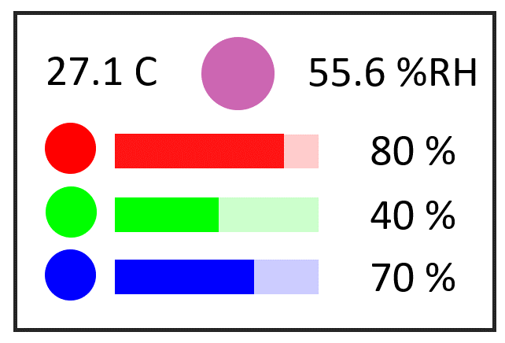
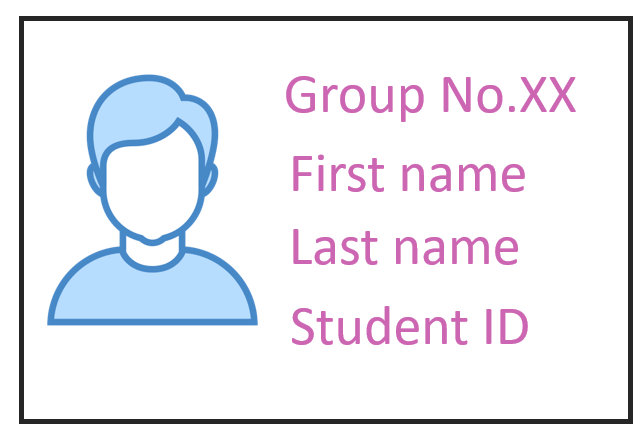

# 01276314 Microcontroller Interfacing, 2026 — Lab 8: LCD and Touch Sensor

Computer Engineering International Program · Department of Computer Engineering, KMITL

---

## Page 1

**Lab 8 LCD and Touch Sensor**

**Objectives**

1. Students should be able to display graphics using LCD.
2. Students should be able to use touch sensor.

### 1. Experiment

#### 1. Screen 1: Mixing RGB colour and display using LCD.

Display the following content on LCD using the layout as shown in Fig 1.1:

- Use white background and black text.
- Show the temperature and relative humidity reading from AM2320 sensor.
- Show the horizontal scroll to adjust brightness of red, green, and blue between 0% - 100%.
- Show the colour created from the red, green, and blue mixture.
- When touching on the red, green, and blue circles, increase the brightness of each colour by 10%.
- Select the appropriate font size and adjust the layout as shown in Fig 1.1.

> **[Fig 1.1]** shows the screen layout for screen 1.

The picture shows a landscape LCD layout with a white background and a thin black rectangular border. Across the top, the temperature reading `27.1 C` appears on the left, a large pink-purple circle showing the mixed colour appears in the centre, and the relative humidity reading `55.6 %RH` appears on the right. The readings use large black text.

Below the readings are three horizontal colour-control rows, ordered red, green, and blue from top to bottom. Each row has a solid circle of its colour on the left, a horizontal rectangular adjustment bar in the middle, and a large black percentage on the right. Each bar has a saturated colour on its left portion and a pale tint of the same colour on its remaining right portion. The example labels are `80 %` for red, `40 %` for green, and `70 %` for blue. The circles, bars, and percentage labels align in three columns. The illustrated bar lengths are approximate rather than exact representations of the printed percentages.

---

## Page 2

### Special Problem 2

#### SP2.1. Screen 2: Display the content on LCD.

Display the following content on LCD using the layout as shown in Fig 1.2.

- Use white background and the mixied colour from Screen 1 for the text.
- Group No.
- Student's first name, last name, ID, and photo.
- Select the appropriate font size and adjust the layout as shown in Fig 1.2.

> **[Fig 1.2]** shows the screen layout for screen 2.

The picture shows a landscape LCD layout with a white background and a thin black rectangular border. A large student-photo placeholder occupies the left side: a head-and-shoulders silhouette with a blue outline, light-blue hair and shirt, and a white face. On the right, four large, left-aligned lines read `Group No.XX`, `First name`, `Last name`, and `Student ID`, arranged from top to bottom with generous vertical spacing. All four lines are pink-purple, illustrating the mixed text colour selected on Screen 1. The photo and text form two side-by-side columns.

#### SP2.2. Change screens using touch sensor.

Display the Screen 1 as shown in Fig 1.1. When touch on the mixed colour circle on top of the LCD, display the Screen 2 as shown in Fig 1.2 for 5 seconds and then display the Screen 1. However, if the photo on the Screen 2 is touched within the 5 second duration, display the Screen 1 immediately.

Adjust LCD backlight using a potentiometer between 20% - 100%.

---

## Page 3

### Lab 8 Submission

*Microcontroller Interfacing 2026*

Date **\_\_\_\_\_\_\_\_\_\_\_\_\_\_\_\_\_\_\_**  Lab Group No. **\_\_\_\_\_\_\_\_\_\_\_\_**

1. Student ID **\_\_\_\_\_\_\_\_\_\_** Name **\_\_\_\_\_\_\_\_\_\_\_\_\_\_\_\_\_\_\_\_\_\_\_\_**
2. Student ID **\_\_\_\_\_\_\_\_\_\_** Name **\_\_\_\_\_\_\_\_\_\_\_\_\_\_\_\_\_\_\_\_\_\_\_\_**
3. Student ID **\_\_\_\_\_\_\_\_\_\_** Name **\_\_\_\_\_\_\_\_\_\_\_\_\_\_\_\_\_\_\_\_\_\_\_\_**

**Checkpoints**

- Experiment 1
